# Arquitectura física de la base de datos

## 1. Descripción general y contexto de despliegue (Supabase / PostgreSQL)

Este repositorio contiene el diseño físico modularizado en archivos `.pgsql` de la base de datos relacional PostgreSQL (Supabase) del sistema de e-commerce. Incluye tipos enumerados, funciones, tablas, índices, triggers y vistas públicas; no contiene un instalador maestro.

> **Nota importante para evaluación:** La base de datos ya se encuentra desplegada y poblada de forma remota en Supabase. Su esquema fue validado contra el backend Spring Boot mediante `spring.jpa.hibernate.ddl-auto=validate`. Por lo tanto, **no es necesario instalar PostgreSQL local ni ejecutar scripts DDL manualmente para levantar y probar el sistema**. Los scripts de este repositorio documentan y versionan el diseño, no son un paso necesario del flujo de ejecución habitual.

| Componente | Repositorio |
|---|---|
| Backend Spring Boot | [e_commerce_back](https://github.com/Lahkpom/e_commerce_back) |
| Frontend React + TypeScript | [e_commerce_front](https://github.com/Lahkpom/e_commerce_front) |
| Base de Datos PostgreSQL (este repositorio) | [e_commerce_db](https://github.com/Lahkpom/e_commerce_db) |

## 2. Diagrama entidad-relación y dominios funcionales

El diagrama representa las relaciones declaradas mediante claves foráneas. Las tablas `users_jn`, `sale_jn` y `sale_return_jn` guardan snapshots sin FKs declaradas a las tablas auditadas. `user_session.replaced_by_session_id` tampoco está definido como FK.

```mermaid
erDiagram
    users ||--o{ user_session : "tiene"
    users ||--o{ user_security_tokens : "tiene"
    users o|--o{ user_login_log : "identifica"
    users o|--o{ sale : "compra o actualiza"
    users o|--o{ shipping_zone : "actualiza"
    users o|--o{ sale_return : "inspecciona"
    users o|--o{ fiscal_receipt : "crea"

    color ||--o{ variant : "clasifica"
    product ||--o{ variant : "ofrece"
    color ||--o{ image : "colorea"
    product ||--o{ image : "ilustra"

    users ||--o{ cart_item : "posee"
    variant ||--o{ cart_item : "se agrega"

    sale ||--o{ sale_item : "contiene"
    variant o|--o{ sale_item : "referencia"
    sale ||--o{ sale_return : "origina"
    sale_return ||--o{ sale_return_item : "incluye"
    sale_item ||--o{ sale_return_item : "se reclama"
    sale ||--o{ fiscal_receipt : "factura"
    sale_return o|--o{ fiscal_receipt : "puede originar"

    users {
        UUID user_id PK
        enum_user_role user_role
        varchar user_email UK
        varchar user_password
        enum_row_status row_status
    }
    user_session {
        UUID session_id PK
        UUID user_id FK
        varchar refresh_token_hash UK
    }
    user_security_tokens {
        UUID token_id PK
        UUID user_id FK
        varchar token_hash UK
    }
    user_login_log {
        BIGINT log_id PK
        UUID user_id FK
        varchar attempted_email
        boolean is_success
    }
    color {
        BIGINT color_id PK
        varchar color_name
        varchar color_code
        enum_row_status row_status
    }
    product {
        UUID product_id PK
        enum_category product_category
        enum_target_gender target_gender
        enum_row_status row_status
    }
    variant {
        BIGINT variant_id PK
        UUID product_id FK
        BIGINT color_id FK
        enum_numeric_size variant_size
        decimal variant_price
        integer variant_stock
    }
    image {
        BIGINT image_id PK
        UUID product_id FK
        BIGINT color_id FK
        text image_url
        boolean is_primary
    }
    cart_item {
        UUID user_id PK, FK
        BIGINT variant_id PK, FK
        integer quantity
    }
    shipping_zone {
        BIGINT shipping_zone_id PK
        enum_shipping_method shipping_method UK
        jsonb postal_codes
    }
    sale {
        UUID sale_id PK
        UUID user_id FK
        UUID tracking_token UK
        enum_sale_status sale_status
        enum_payment_status payment_status
    }
    sale_item {
        BIGINT sale_item_id PK
        UUID sale_id FK
        BIGINT variant_id FK
        integer quantity
        decimal subtotal
    }
    fiscal_receipt {
        UUID fiscal_receipt_id PK
        UUID sale_id FK
        UUID return_id FK
        fiscal_receipt_type receipt_type
        bigint receipt_number
    }
    sale_return {
        UUID return_id PK
        UUID sale_id FK
        UUID tracking_token UK
        enum_return_status return_status
    }
    sale_return_item {
        BIGINT return_item_id PK
        UUID return_id FK
        BIGINT sale_item_id FK
        integer quantity
    }
    users_jn {
        BIGINT jn_id PK
        UUID user_id
        varchar jn_operation
    }
    sale_jn {
        BIGINT jn_id PK
        UUID sale_id
        varchar jn_operation
    }
    sale_return_jn {
        BIGINT jn_id PK
        UUID return_id
        varchar jn_operation
    }
```



### Tipos `ENUM` personalizados (14)

Los literales son exactos y sensibles a mayúsculas/minúsculas.

| Tipo | Valores |
|---|---|
| `enum_category` | `CALZADO` |
| `enum_numeric_size` | `T_18`, `T_19`, `T_20`, `T_21`, `T_22`, `T_23`, `T_24`, `T_25`, `T_26`, `T_35`, `T_36`, `T_37`, `T_38`, `T_39`, `T_40`, `T_41`, `T_42`, `T_35_36`, `T_37_38`, `T_39_40`, `T_41_42`, `T_43_44`, `T_45_46` |
| `enum_payment_method` | `MERCADO_PAGO`, `TRANSFERENCIA`, `EFECTIVO` |
| `enum_payment_status` | `PENDIENTE`, `APROBADO`, `RECHAZADO`, `REEMBOLSO_PENDIENTE`, `REEMBOLSADO` |
| `enum_return_reason` | `ARREPENTIMIENTO_LEGAL`, `CAMBIO_TALLE`, `DEFECTO_FABRICACION` |
| `enum_return_resolution` | `REEMBOLSO_DINERO`, `CAMBIO_PRODUCTO`, `CREDITO_TIENDA` |
| `enum_return_status` | `SOLICITADA`, `EN_TRANSITO`, `RECIBIDO_EN_CONTROL`, `APROBADA`, `RECHAZADA`, `CANCELADA` |
| `enum_row_status` | `ACTIVE`, `INACTIVE`, `DELETED` |
| `enum_sale_status` | `PENDIENTE`, `PREPARACION`, `ENVIADO`, `ENTREGADO`, `CANCELADO`, `REEMBOLSADO`, `AUDITORIA`, `RECLAMO_ABIERTO`, `CERRADO_CON_DEVOLUCION` |
| `enum_shipping_method` | `RETIRO_LLAVALLOL`, `ENVIO_GBA_ZONA_SUR`, `ENVIO_GBA_GENERAL`, `ENVIO_CORREO_NACIONAL` |
| `enum_target_gender` | `NINIAS`, `NINIOS`, `HOMBRES`, `MUJERES`, `UNISEX` |
| `enum_user_role` | `ADMIN`, `OPERATOR`, `WHOLESALER`, `CUSTOMER` |
| `fiscal_receipt_type` | `FACTURA_C`, `NOTA_DEBITO_C`, `NOTA_CREDITO_C` |
| `tax_id_type` | `DNI`, `CUIL`, `CUIT`, `PASAPORTE` |

No se declara ningún `DOMAIN`. `pgcrypto` es la única extensión PostgreSQL mencionada en los scripts. `gen_random_uuid()` se usa como default en IDs UUID.

### Identidad y seguridad

| Tabla | PK | Relaciones y reglas principales | Índices explícitos |
|---|---|---|---|
| `users` | `user_id UUID DEFAULT gen_random_uuid()` | Rol `enum_user_role` por defecto `CUSTOMER`; email validado por regex; contador de intentos `failed_login_attempts >= 0`; `password_expires_at` expira a 180 días; estado lógico `row_status`. `user_password` almacena el hash proporcionado, no transforma texto automáticamente. | `uk_user_email_not_deleted`: único sobre `LOWER(user_email)` mientras `row_status <> 'DELETED'`; `idx_users_role_status`; `idx_users_tax_id`. |
| `user_session` | `session_id UUID DEFAULT gen_random_uuid()` | `user_id -> users ON DELETE CASCADE`; `refresh_token_hash` es único; tiene expiración, revocación, última actividad e IP. `replaced_by_session_id` no es FK. | `idx_user_session_lookup` (`user_id`) y `idx_user_session_token_active` (`refresh_token_hash`), ambos parciales `WHERE is_revoked = FALSE`. |
| `user_security_tokens` | `token_id UUID DEFAULT gen_random_uuid()` | `user_id -> users ON DELETE CASCADE`; `token_hash` único; tipo, vencimiento y consumo del token. | `idx_sec_tokens_lookup` sobre `token_hash`, `WHERE consumed_at IS NULL`. |
| `user_login_log` | `log_id BIGINT GENERATED ALWAYS AS IDENTITY` | `user_id -> users ON DELETE SET NULL`; el email intentado permanece aunque el usuario no exista. Registra éxito/fallo, IP, agente y fecha. | `idx_login_log_user`, `idx_login_log_ip`; `idx_login_log_email_recent` (`LOWER(attempted_email)`, fecha) parcial para fallos. |

### Catálogo y multimedia

| Tabla | PK | Relaciones y reglas principales | Índices explícitos |
|---|---|---|---|
| `color` | `color_id BIGINT IDENTITY` | `color_code` debe satisfacer `^#[A-Fa-f0-9]{6}$`; `row_status` permite baja lógica. | `uk_color_name_not_deleted` por nombre sin distinguir mayúsculas y `uk_color_code_not_deleted` por código normalizado, ambos parciales `WHERE row_status <> 'DELETED'`. |
| `product` | `product_id UUID DEFAULT gen_random_uuid()` | Categoría, público objetivo, nombre y descripciones obligatorios; baja lógica por `row_status`. | `uk_product_name_not_deleted` por `LOWER(product_name)` y `idx_product_gender_status` por público/estado, parciales para filas `ACTIVE` o `INACTIVE`. |
| `variant` | `variant_id BIGINT IDENTITY` | `product_id -> product`; `color_id -> color`; talle `enum_numeric_size`; `variant_price >= 0`; `variant_stock >= 0` (default 0). | `uk_product_color_size_not_deleted` y `uk_variant_sku_not_deleted`, únicos parciales para `ACTIVE`/`INACTIVE`; `idx_variant_product`, `idx_variant_color`, también parciales. |
| `image` | `image_id BIGINT IDENTITY` | `product_id -> product ON DELETE CASCADE`; `color_id -> color`; URL obligatoria. | `idx_image_product_color`; `uq_image_product_color_primary` único por `(product_id, color_id)` `WHERE is_primary = TRUE`, limita a una imagen principal por producto/color. |

### Carrito y logística

| Tabla | PK | Relaciones y reglas principales | Índices explícitos |
|---|---|---|---|
| `cart_item` | Compuesta `(user_id, variant_id)` | `user_id -> users ON DELETE CASCADE`; `variant_id -> variant ON DELETE CASCADE`; `quantity` entre `1` y `10000`, default `1`. | `idx_cart_item_variant`. |
| `shipping_zone` | `shipping_zone_id BIGINT IDENTITY` | Método de envío único; `postal_codes JSONB NOT NULL DEFAULT '[]'`; costo base `>= 0`; `updated_by -> users ON DELETE SET NULL`. | `idx_shipping_zone_postal_codes` (GIN sobre JSONB); `idx_shipping_zone_status`. |

### Ventas, facturación ARCA y posventa

| Tabla | PK | Relaciones y reglas principales | Índices explícitos |
|---|---|---|---|
| `sale` | `sale_id UUID DEFAULT gen_random_uuid()` | `user_id -> users ON DELETE SET NULL`; `updated_by -> users ON DELETE SET NULL`; `tracking_token` único para seguimiento; snapshots de contacto/entrega; `sale_total = sale_subtotal - sale_discount_amount + shipping_cost`, con cantidades, subtotal, descuento y costo sujetos a `CHECK`. | `idx_sale_user`, `idx_sale_customer_email` (`LOWER(customer_email)`), `idx_sale_customer_tax_id`, `idx_sale_status`, `idx_sale_payment_status`, `idx_sale_created_at` (`created_at DESC`), `idx_sale_mp_payment` parcial si existe pago MP, `idx_sale_fiscal_rejection` parcial `WHERE fiscal_rejection = TRUE`, `uq_sale_tracking_token`. |
| `sale_item` | `sale_item_id BIGINT IDENTITY` | `sale_id -> sale ON DELETE CASCADE`; `variant_id -> variant ON DELETE SET NULL`. Conserva snapshot de producto, descripción, SKU, talle, color, imagen, precio unitario, cantidad y subtotal. El subtotal debe ser precio por cantidad. | `idx_sale_item_sale`; `idx_sale_item_variant`. |
| `fiscal_receipt` | `fiscal_receipt_id UUID DEFAULT gen_random_uuid()` | FKs a `sale`, opcionalmente `sale_return`, y opcionalmente `users` en `created_by`. Snapshot fiscal de receptor, importes, CAE y QR. | Único `(receipt_type, point_of_sale, receipt_number)`; índices `idx_fiscal_receipt_sale`, `idx_fiscal_receipt_return`, `idx_fiscal_receipt_cae`, `idx_fiscal_receipt_dates` sobre `issue_date`. |
| `sale_return` | `return_id UUID DEFAULT gen_random_uuid()` | `sale_id -> sale ON DELETE RESTRICT`; `inspected_by -> users ON DELETE SET NULL`; token de seguimiento único; resolución/estado tipificados; reembolso `>= 0`. | `idx_sale_return_sale`, `idx_sale_return_status`, `idx_sale_return_created_at`, `uq_sale_return_tracking`. |
| `sale_return_item` | `return_item_id BIGINT IDENTITY` | `return_id -> sale_return ON DELETE CASCADE`; `sale_item_id -> sale_item ON DELETE RESTRICT`; cantidad `> 0`; dictamen individual en `restock_approved` y `rejection_reason`; único `(return_id, sale_item_id)`. | `idx_sale_return_item_return`, `idx_sale_return_item_sale_item`, `uq_return_sale_item`. |

### Auditoría y journals

| Tabla | PK y contenido | Relaciones / índices |
|---|---|---|
| `users_jn` | `jn_id BIGINT IDENTITY`; snapshot de usuario anterior a cambios, incluyendo rol, hash de contraseña, estado y marcas de tiempo. `jn_operation` solo acepta `UPDATE` o `DELETE`. | Sin FK declarada; `idx_users_jn_user_id` (`user_id`, `jn_timestamp DESC`). |
| `sale_jn` | `jn_id BIGINT IDENTITY`; snapshot previo de la venta para `UPDATE`/`DELETE`, con datos de checkout, importes, estados y pasarela. | Sin FK declarada; `idx_sale_jn_sale_id` (`sale_id`, `jn_timestamp DESC`). |
| `sale_return_jn` | `jn_id BIGINT IDENTITY`; snapshot previo del expediente de devolución para `UPDATE`/`DELETE`. | Sin FK declarada; `idx_sale_return_jn_return_id` (`return_id`, `jn_timestamp DESC`). |

Todas las FKs que no especifican explícitamente `ON DELETE` usan la acción predeterminada `NO ACTION`; no hay cláusulas explícitas `ON UPDATE`.

## 3. Automatización embebida en PostgreSQL

### Funciones PL/pgSQL y funciones llamadas por triggers

| Función | Comportamiento |
|---|---|
| `update_updated_at_column()` | Asigna `NOW()` a `NEW.updated_at` y retorna la fila. |
| `trg_fn_update_user_last_login()` | Tras INSERT exitoso en `user_login_log` con usuario asociado, actualiza `users.last_login_at`, limpia `failed_login_attempts` y pone `locked_until` en `NULL`. |
| `trg_fn_audit_users()` | Copia `OLD` a `users_jn` en UPDATE/DELETE. |
| `trg_fn_audit_sale()` | Copia `OLD` a `sale_jn` en UPDATE/DELETE. |
| `trg_fn_audit_sale_return()` | Copia `OLD` a `sale_return_jn` en UPDATE/DELETE. |
| `purge_expired_sessions_and_logs(p_session_days INTEGER DEFAULT 30, p_log_days INTEGER DEFAULT 90)` | Función `RETURNS VOID` que borra sesiones revocadas o vencidas antiguas y logs de login anteriores al umbral. El script la define; no la agenda ni la invoca. |

Las funciones de auditoría leen `current_setting('app.current_user', true)` para obtener al actor de aplicación; si no está seteado, usan `SESSION_USER`. Los snapshots capturan los valores `OLD`.

### Triggers (13)

Todos son `FOR EACH ROW`.

| Trigger | Tabla | Evento | Efecto |
|---|---|---|---|
| `trg_color_update` | `color` | `BEFORE UPDATE` | Actualiza `updated_at`. |
| `trg_image_updated_at` | `image` | `BEFORE UPDATE` | Actualiza `updated_at`. |
| `trg_product_update` | `product` | `BEFORE UPDATE` | Actualiza `updated_at`. |
| `trg_variant_update` | `variant` | `BEFORE UPDATE` | Actualiza `updated_at`. |
| `trg_cart_item_updated_at` | `cart_item` | `BEFORE UPDATE` | Actualiza `updated_at`. |
| `trg_sale_update` | `sale` | `BEFORE UPDATE` | Actualiza `updated_at`. |
| `trg_sale_audit` | `sale` | `AFTER UPDATE OR DELETE` | Inserta snapshot previo en `sale_jn`. |
| `trg_sale_return_update` | `sale_return` | `BEFORE UPDATE` | Actualiza `updated_at`. |
| `trg_sale_return_audit` | `sale_return` | `AFTER UPDATE OR DELETE` | Inserta snapshot previo en `sale_return_jn`. |
| `trg_shipping_zone_update` | `shipping_zone` | `BEFORE UPDATE` | Actualiza `updated_at`. |
| `trg_user_login_success` | `user_login_log` | `AFTER INSERT` | En login exitoso, actualiza último acceso y limpia bloqueo/contador en `users`. |
| `trg_user_update` | `users` | `BEFORE UPDATE` | Actualiza `updated_at`. |
| `trg_users_audit` | `users` | `AFTER UPDATE OR DELETE` | Inserta snapshot previo en `users_jn`. |

### Vistas públicas

| Vista | Contenido |
|---|---|
| `v_public_product_catalog` | Catálogo de productos activos con variantes y colores activos; calcula precio mínimo, cantidad de talles y colores, y agrega en JSONB las imágenes principales por color. Esa agregación entrega una vista de catálogo lista para consumir sin consultar cada galería por separado. |
| `v_public_product_variants` | Detalle de variantes activas de productos/colores activos, con talle, precio, stock e imágenes por producto/color ordenadas con la principal primero. |

### Estrategia de índices

Se usan índices parciales para acotar entradas a filas operativas o casos consultados: `WHERE row_status <> 'DELETED'` en unicidad de email/color; `WHERE row_status IN ('ACTIVE', 'INACTIVE')` para catálogo y SKU/talle; `WHERE is_revoked = FALSE` para sesiones activas; `WHERE consumed_at IS NULL` para tokens vigentes; y `WHERE fiscal_rejection = TRUE` o `mp_payment_id IS NOT NULL` para búsquedas puntuales de ventas. Hay índices compuestos para consultas por entidad y fecha, índices sobre expresiones como `LOWER(email)`, un índice GIN para `postal_codes JSONB` y unicidad compuesta para comprobantes fiscales e imágenes principales.

## 4. Orden de ejecución desde cero e inserción manual de datos

> Estos pasos son una referencia de dependencias para un entorno nuevo; no son necesarios para levantar y probar el sistema desplegado en Supabase descrito en la sección 1. No ejecutar sobre una base existente sin evaluar previamente el impacto.

Los 14 archivos de enums son independientes. Este orden topológico enumera los 36 archivos `.pgsql` una sola vez. Antes de ejecutar `tables/user/users.pgsql`, ejecutar `CREATE EXTENSION IF NOT EXISTS pgcrypto;`: esa extensión no tiene archivo modular propio y su sentencia también aparece dentro de `users.pgsql`.

1. `enums/enum_category.pgsql`
2. `enums/enum_numeric_size.pgsql`
3. `enums/enum_payment_method.pgsql`
4. `enums/enum_payment_status.pgsql`
5. `enums/enum_return_reason.pgsql`
6. `enums/enum_return_resolution.pgsql`
7. `enums/enum_return_status.pgsql`
8. `enums/enum_row_status.pgsql`
9. `enums/enum_sale_status.pgsql`
10. `enums/enum_shipping_method.pgsql`
11. `enums/enum_target_gender.pgsql`
12. `enums/enum_user_role.pgsql`
13. `enums/fiscal_receipt_type.pgsql`
14. `enums/tax_id_type.pgsql`
15. `functions/update_updated_at_column.pgsql`

**Extensión, antes del archivo 18:** `CREATE EXTENSION IF NOT EXISTS pgcrypto;` (sentencia SQL incluida en `tables/user/users.pgsql`; no es un archivo adicional).

16. `tables/product/color.pgsql`
17. `tables/product/product.pgsql`
18. `tables/user/users.pgsql`
19. `tables/product/variant.pgsql`
20. `tables/product/image.pgsql`
21. `tables/user/user_session.pgsql`
22. `tables/user/user_security_tokens.pgsql`
23. `tables/user/user_login_log.pgsql`
24. `tables/user/users_jn.pgsql`
25. `tables/sale/sale.pgsql`
26. `tables/sale/shipping_zone.pgsql`
27. `tables/sale/cart_item.pgsql`
28. `tables/sale/sale_item.pgsql`
29. `tables/sale/sale_return.pgsql`
30. `tables/sale/sale_jn.pgsql`
31. `tables/sale/sale_return_item.pgsql`
32. `tables/sale/sale_return_jn.pgsql`
33. `tables/sale/fiscal_receipt.pgsql`
34. `tables/user/purge_expired_sessions_and_logs.pgsql`
35. `views/public/product/v_public_product_catalog.pgsql`
36. `views/public/variant/v_public_product_variants.pgsql`

### Insertar manualmente un usuario con hash BCrypt

`user_password` es `VARCHAR(255) NOT NULL`, no tiene default ni trigger de hashing. **No se debe almacenar la contraseña en texto plano.** `pgcrypto` proporciona `crypt` y `gen_salt`; el algoritmo `bf` genera un hash BCrypt compatible con `BCryptPasswordEncoder` de Spring Security.

Ejecutar con un rol que tenga permiso para crear/habilitar la extensión:

```sql
CREATE EXTENSION IF NOT EXISTS pgcrypto;

INSERT INTO users (
    user_name,
    user_email,
    user_password,
    user_role,
    is_email_verified,
    must_change_password
) VALUES (
    'Usuario de prueba',
    'usuario.prueba@example.com',
    crypt('PasswordPorDefecto123!', gen_salt('bf', 10)),
    'CUSTOMER',
    FALSE,
    TRUE
)
RETURNING user_id, user_email, user_role;
```

El UUID, estado, fechas y demás columnas con defaults se generan automáticamente. Usar una contraseña de prueba apropiada al entorno; no conservar contraseñas de demostración en producción. Si `pgcrypto` ya está habilitada, `CREATE EXTENSION IF NOT EXISTS` no la vuelve a crear.

### Insertar encadenadamente catálogo y zona de envío

El siguiente bloque se puede ejecutar completo desde SQL Editor de Supabase o `psql`. Crea primero color y producto, después variante e imagen usando las claves retornadas, y configura una zona de envío. Los valores enum y relaciones corresponden a los declarados en los scripts.

```sql
WITH new_color AS (
    INSERT INTO color (color_name, color_desc, color_code)
    VALUES ('Azul prueba', 'Color de ejemplo', '#3366CC')
    RETURNING color_id
),
new_product AS (
    INSERT INTO product (
        product_category,
        target_gender,
        product_name,
        product_short_desc,
        product_long_desc
    )
    SELECT
        'CALZADO',
        'UNISEX',
        'Producto de prueba',
        'Descripción breve de prueba',
        'Descripción completa de prueba'
    FROM new_color
    RETURNING product_id
),
new_variant AS (
    INSERT INTO variant (
        product_id,
        color_id,
        variant_size,
        variant_desc,
        variant_sku,
        variant_price,
        variant_stock
    )
    SELECT
        new_product.product_id,
        new_color.color_id,
        'T_37',
        'Variante de prueba talle 37',
        'SKU-PRUEBA-37-AZUL',
        25000.00,
        5
    FROM new_product
    CROSS JOIN new_color
    RETURNING variant_id, product_id, color_id
),
new_image AS (
    INSERT INTO image (product_id, color_id, image_url, is_primary)
    SELECT product_id, color_id, 'https://example.com/producto-prueba.jpg', TRUE
    FROM new_variant
    RETURNING image_id
),
new_shipping_zone AS (
    INSERT INTO shipping_zone (
        shipping_method,
        zone_name,
        description,
        postal_codes,
        base_cost,
        estimated_days
    )
    VALUES (
        'RETIRO_LLAVALLOL',
        'Retiro en punto de entrega',
        'Zona de ejemplo para retiro',
        '[]'::jsonb,
        0.00,
        'A coordinar'
    )
    RETURNING shipping_zone_id
)
SELECT
    new_variant.product_id,
    new_variant.variant_id,
    new_image.image_id,
    new_shipping_zone.shipping_zone_id
FROM new_variant
CROSS JOIN new_image
CROSS JOIN new_shipping_zone;
```

El ejemplo es ilustrativo y deja registros en la base de datos donde se ejecute. Cambiar los valores únicos (`color_name`, `product_name`, `variant_sku`) y el método de envío si ya existen filas equivalentes.
